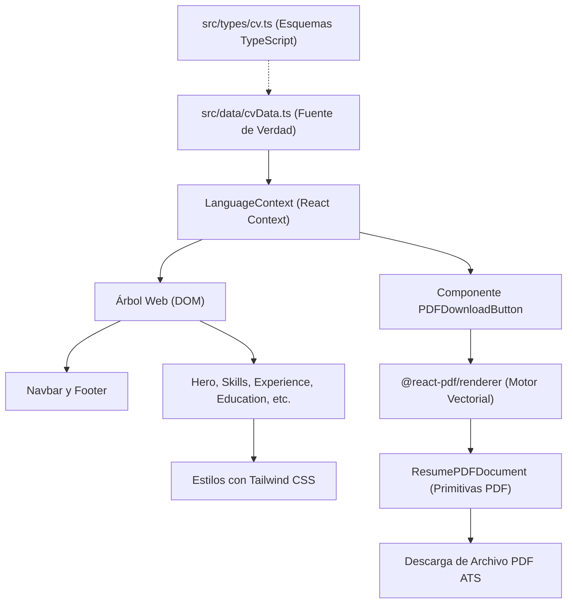

# Curriculum Vitae Web & Portafolio Profesional

> Aplicación web interactiva, moderna y de alto rendimiento, bilingüe (Español e Inglés), con generador integrado de currículum en PDF vectorial 100% compatible con ATS (*Applicant Tracking Systems*). Desarrollada con **React 19**, **Vite 6**, **TypeScript 5** y **Tailwind CSS**. Despliegue en **Google Firebase Hosting** y contenedorización lista con **Docker y Nginx**.

[](https://react.dev/)
[](https://vitejs.dev/)
[](https://www.typescriptlang.org/)
[](https://tailwindcss.com/)
[](https://firebase.google.com/docs/hosting)
[](https://www.docker.com/)
[](LICENSE)

*Leer en otros idiomas: [English (README.md)](README.md).*

---

## Descripción General

En el mercado tecnológico actual, los desarrolladores y líderes técnicos necesitan dos representaciones distintas de su trayectoria profesional:
1. **Un portafolio web interactivo y responsivo** que reclutadores, gerentes de ingeniería y colegas puedan explorar con fluidez, con soporte para temas claro/oscuro y cambio de idioma instantáneo.
2. **Un currículum en PDF limpio y estructurado** que supere sin fallos los filtros automatizados **ATS (Applicant Tracking Systems)**, evitando problemas de diseño, tablas complejas o texto rasterizado en imágenes.

Este proyecto resuelve ambas necesidades con una arquitectura basada en **una única fuente de verdad**. Desarrollado con **React 19** y **Vite**, todos los datos del CV residen en archivos TypeScript estructurados (`src/data/cvData.ts`), desacoplando por completo el contenido de la presentación visual. La interfaz web renderiza un diseño limpio para móviles y escritorio con **Tailwind CSS**, mientras que la descarga de PDF ejecuta `@react-pdf/renderer` en el navegador en tiempo real para generar un documento vectorial seleccionable y optimizado para ATS.

### Características Principales
- 🌐 **Soporte Bilingüe Inmediato (ES / EN)**: Conmutación fluida entre Español e Inglés en toda la interfaz web y en el PDF descargable.
- 📄 **Generación de PDF Compatible con ATS**: Construcción en el cliente mediante `@react-pdf/renderer` con texto vectorial seleccionable y estructura lineal para lectura automática en sistemas de reclutamiento.
- 🎨 **Diseño en Tonos Azules & Tema Dual**: Paleta en azul cobalto y azul marino con contrastes claros y persistencia de configuración del usuario.
- ⚡ **Alojamiento Estático de Alto Desempeño**: Empaquetado SPA optimizado alojado en Google Firebase Hosting con despliegue continuo automatizado (CI/CD) en GitHub Actions.
- 🐳 **Contenedorización en Docker para Producción**: Contenedor multi-etapa sobre Alpine Linux con servidor web Nginx configurado con compresión gzip y cabeceras de caché inmutable.

---

## Tabla de Contenidos

- [Descripción General](#descripción-general)
- [Inicio Rápido](#inicio-rápido)
- [Requisitos Previos](#requisitos-previos)
- [Instalación](#instalación)
- [Configuración](#configuración)
  - [Personalización de Datos del CV](#personalización-de-datos-del-cv)
  - [Configuración de Firebase](#configuración-de-firebase)
- [Uso](#uso)
  - [Navegación Web Interactiva](#navegación-web-interactiva)
  - [Descarga del PDF ATS](#descarga-del-pdf-ats)
- [Arquitectura](#arquitectura)
  - [Flujo de Datos & Única Fuente de Verdad](#flujo-de-datos--única-fuente-de-verdad)
  - [Canal de Renderizado Dual](#canal-de-renderizado-dual)
- [Estructura del Proyecto](#estructura-del-proyecto)
- [Desarrollo](#desarrollo)
  - [Comandos Disponibles](#comandos-disponibles)
  - [Filtro Estricto de TypeScript](#filtro-estricto-de-typescript)
- [Referencia de Esquema de Datos](#referencia-de-esquema-de-datos)
- [Pruebas Automatizadas](#pruebas-automatizadas)
- [Despliegue](#despliegue)
  - [Google Firebase Hosting (Manual)](#google-firebase-hosting-manual)
  - [Despliegue Continuo (GitHub Actions)](#despliegue-continuo-github-actions)
  - [Docker & Docker Compose](#docker--docker-compose)
- [Preguntas Frecuentes y Solución de Problemas](#preguntas-frecuentes-y-solución-de-problemas)
- [Contribución](#contribución)
- [Licencia](#licencia)
- [Agradecimientos](#agradecimientos)

---

## Inicio Rápido

Poner en marcha el entorno de desarrollo toma solo tres pasos:

```bash
# 1. Instalar dependencias exactas
npm ci

# 2. Iniciar el servidor local de Vite
npm run dev

# 3. Abrir en el navegador en http://localhost:5173
```

O si prefieres utilizar Docker:

```bash
docker compose up --build -d
# Abrir en http://localhost:8080
```

---

## Requisitos Previos

| Requisito | Versión Recomendada | Propósito |
|-----------|---------------------|-----------|
| **Node.js** | `>= 20.x` (o `22.x`) | Entorno de ejecución |
| **npm** | `>= 10.x` | Gestor de paquetes |
| **Docker** *(Opcional)* | `>= 24.x` | Vista previa en contenedor |
| **Docker Compose** *(Opcional)* | `>= 2.20.x` | Orquestación local |
| **Firebase CLI** *(Opcional)* | `latest` (`firebase-tools`) | Despliegue manual |

---

## Instalación

1. **Clonar el repositorio**:
   ```bash
   git clone https://github.com/ronald32acunadev/curriculumvitae.git
   cd curriculumvitae
   ```

2. **Instalar dependencias**:
   ```bash
   npm ci
   ```

3. **Verificar la compilación**:
   ```bash
   npm run build
   ```

---

## Configuración

### Personalización de Datos del CV

Toda la información del currículum, enlaces personales, habilidades y experiencia laboral residen en un módulo centralizado:
👉 [`src/data/cvData.ts`](src/data/cvData.ts)

El archivo exporta:
1. `cvData`: Objeto `BilingualCVData` con ramas `es` y `en`.
2. `uiLabels`: Diccionario con las etiquetas de interfaz y navegación.

#### Paso 1: Datos Personales y de Contacto
```typescript
contact: {
  name: "Tu Nombre",
  headline: "Senior Software Architect / Staff Engineer",
  phone: "+506 8572-4776",
  email: "tu.correo@ejemplo.com",
  location: "Alajuela, Costa Rica",
  linkedinUrl: "https://linkedin.com/in/tu-usuario",
  githubUrl: "https://github.com/tu-usuario",
  portfolioUrl: "https://tu-sitio.web.app",
}
```

#### Paso 2: Experiencia Laboral y Logros
```typescript
{
  id: "exp-1",
  company: "Nombre de la Empresa",
  role: "Developer Team Lead",
  location: "Remoto",
  workplaceType: "Remote",
  startDate: "2021/04",
  endDate: "Presente",
  responsibilities: [
    "Diseño de arquitectura de microservicios con alta disponibilidad.",
    "Liderazgo técnico de equipos ágiles e implementación de pipelines CI/CD."
  ],
  technologies: [".NET 10", "TypeScript", "Azure", "Kubernetes"]
}
```

#### Paso 3: Habilidades Técnicas y Blandas
```typescript
technicalSkills: [
  {
    categoryName: "Lenguajes de Programación",
    skills: ["C#", "TypeScript", "Python", "SQL"]
  }
]
```

### Configuración de Firebase

El proyecto está configurado para desplegar en el ID `curriculum-88377`:
- [`.firebaserc`](.firebaserc): Asocia el alias por defecto con el proyecto en Firebase.
- [`firebase.json`](firebase.json): Define las reglas de reescritura SPA hacia `/index.html` y cabeceras de caché inmutable para `/assets/**`.

Para vincular otro proyecto de Firebase:
```bash
npx firebase use --add
```

---

## Uso

### Navegación Web Interactiva

- **Selector de Idioma**: El botón en la barra superior alterna entre Español e Inglés al instante. Guarda la preferencia en `localStorage["cv_language"]` y actualiza el atributo `lang` del documento HTML.
- **Navegación por Secciones**: Enlaces directos a Resumen, Habilidades, Experiencia, Educación y Certificaciones.
- **Insignias y Verificaciones**: Los botones de credenciales abren los certificados oficiales en pestañas externas seguras (`rel="noopener noreferrer"`).

### Descarga del PDF ATS

Al pulsar **Descargar CV (PDF)**:
1. Se obtiene la selección de idioma activa desde `LanguageContext`.
2. `@react-pdf/renderer` construye el árbol del documento en memoria (`ResumePDFDocument`).
3. Se produce un archivo Blob que se descarga como `CV_<Nombre>_<LANG>.pdf`.
4. El archivo utiliza fuentes estándar (Helvetica), texto vectorial y estructura lineal garantizando la lectura automática en plataformas ATS.

---

## Arquitectura

### Flujo de Datos & Única Fuente de Verdad



### Canal de Renderizado Dual

1. **Destino Web (DOM)**: Utiliza etiquetas semánticas de HTML5 (`<header>`, `<main>`, `<section>`), hooks de React y utilidades de Tailwind CSS.
2. **Destino PDF**: No utiliza el DOM del navegador. Se construye con los componentes de `@react-pdf/renderer` (`<Document>`, `<Page>`, `<View>`, `<Text>`, `<Link>`) con estilos en puntos tipográficos (`pt`).

---

## Estructura del Proyecto

```
curriculumvitae/
├── .github/
│   └── workflows/
│       └── deploy.yml            # Pipeline CI/CD en GitHub Actions
├── public/                       # Recursos estáticos servidos directamente
├── src/
│   ├── agents/                   # Scripts de verificación y agentes
│   │   └── verifyLibraries.agent.ts
│   ├── components/
│   │   ├── layout/               # Barra de navegación y pie de página
│   │   │   ├── Footer.tsx
│   │   │   └── Navbar.tsx
│   │   ├── pdf/                  # Renderizado y descarga de PDF
│   │   │   ├── PDFDownloadButton.tsx
│   │   │   └── ResumePDFDocument.tsx
│   │   ├── sections/             # Secciones modulares del currículum
│   │   │   ├── CertificationsSection.tsx
│   │   │   ├── ContactSection.tsx
│   │   │   ├── EducationSection.tsx
│   │   │   ├── ExperienceSection.tsx
│   │   │   ├── HeroSection.tsx
│   │   │   ├── SkillsSection.tsx
│   │   │   └── SummarySection.tsx
│   │   └── ui/                   # Componentes atómicos (Card, Badge, Icons)
│   ├── context/
│   │   └── LanguageContext.tsx   # Estado global bilingüe y persistencia
│   ├── data/
│   │   └── cvData.ts             # Datos del currículum y textos de interfaz
│   ├── test/
│   │   └── setup.ts              # Configuración global de pruebas (mock localStorage)
│   ├── types/
│   │   └── cv.ts                 # Contratos y tipos en TypeScript
│   ├── App.tsx                   # Estructura principal de la aplicación
│   ├── index.css                 # Estilos globales y Tailwind CSS
│   └── main.tsx                  # Punto de entrada de React 19
├── Dockerfile                    # Contenedor multi-etapa optimizado
├── docker-compose.yml            # Configuración para Docker Compose
├── firebase.json                 # Reglas de enrutamiento y caché en Firebase
├── LICENSE                       # Licencia de código abierto MIT
├── nginx.conf                    # Configuración optimizada de Nginx
├── package.json                  # Scripts y dependencias
├── tailwind.config.js            # Configuración de Tailwind y colores de marca
├── tsconfig.app.json             # Reglas estrictas de compilación de TypeScript
└── vite.config.ts                # Configuración de Vite y Vitest
```

---

## Desarrollo

### Comandos Disponibles

| Comando | Acción | Salida / Objetivo |
|---------|--------|-------------------|
| `npm run dev` | Inicia el servidor de desarrollo con HMR | `http://localhost:5173` |
| `npm run build` | Verificación estricta de tipos (`tsc -b`) y compilación para producción | `dist/` |
| `npm run preview` | Servidor local para previsualizar el bundle de producción | `http://localhost:4173` |
| `npm test` | Ejecución de la suite de pruebas unitarias | Reporte en consola |
| `npm run deploy` | Compila y despliega a Firebase Hosting | Canal en vivo |

### Filtro Estricto de TypeScript

El comando `npm run build` ejecuta `tsc -b` con validaciones estrictas (`strict`, `noUnusedLocals`, `noUnusedParameters`). Cualquier variable sin usar o tipo incorrecto en el código o en las pruebas interrumpirá la compilación.

---

## Referencia de Esquema de Datos

Los tipos principales se encuentran en [`src/types/cv.ts`](src/types/cv.ts):

```typescript
export interface ContactInfo {
  name: string;
  headline: string;
  phone: string;
  email: string;
  secondaryEmails?: string[];
  location: string;
  linkedinUrl?: string;
  githubUrl?: string;
  portfolioUrl?: string;
  instagramUrl?: string;
  facebookUrl?: string;
}

export interface SkillCategory {
  categoryName: string;
  skills: string[];
}

export interface ExperienceItem {
  id: string;
  company: string;
  role: string;
  location: string;
  workplaceType: 'Remote' | 'On-Site' | 'Hybrid';
  startDate: string;
  endDate: string;
  responsibilities: string[];
  technologies?: string[];
}

export interface EducationItem {
  id: string;
  degree: string;
  institution: string;
  location: string;
  startDate: string;
  endDate: string;
  description?: string;
}

export interface CertificationItem {
  id: string;
  title: string;
  issuer: string;
  date: string;
  verificationUrl?: string;
  credentialType?: 'online' | 'physical';
}

export interface LanguageItem {
  name: string;
  level: string;
}

export interface CVContent {
  contact: ContactInfo;
  summary: string;
  languages: LanguageItem[];
  softSkills: string[];
  technicalSkills: SkillCategory[];
  experience: ExperienceItem[];
  education: EducationItem[];
  certifications: CertificationItem[];
}
```

---

## Pruebas Automatizadas

La suite de pruebas utiliza **Vitest**, **jsdom** y **React Testing Library**:

- **Contexto** ([`contexts.test.tsx`](src/context/contexts.test.tsx)): Valida el cambio de idioma y persistencia en `localStorage`.
- **Componentes** ([`sections.test.tsx`](src/components/sections/sections.test.tsx), [`Navbar.test.tsx`](src/components/layout/Navbar.test.tsx)): Comprueba el renderizado de secciones y barra de navegación.
- **PDF** ([`ResumePDFDocument.test.ts`](src/components/pdf/ResumePDFDocument.test.ts)): Valida la generación del árbol de componentes de PDF sin errores.
- **Integridad de Datos** ([`cvData.test.ts`](src/data/cvData.test.ts)): Comprueba la paridad entre las ramas `es` e `en`.

Comandos de ejecución:
```bash
# Correr todas las pruebas
npm test

# Ejecutar una prueba específica
npx vitest run src/context/contexts.test.tsx
```

---

## Despliegue

### Google Firebase Hosting (Manual)

1. Iniciar sesión en Firebase:
   ```bash
   npx firebase login
   ```
2. Asociar el proyecto:
   ```bash
   npx firebase use curriculum-88377
   ```
3. Compilar y publicar:
   ```bash
   npm run deploy
   ```

### Despliegue Continuo (GitHub Actions)

El archivo [`.github/workflows/deploy.yml`](.github/workflows/deploy.yml) automatiza el despliegue con cada `push` a la rama `main`:
1. Clona el repositorio y configura Node.js 20.
2. Instala dependencias con `npm ci`.
3. Ejecuta la suite de pruebas unitarias (`npm test`).
4. Genera el bundle de producción (`npm run build`).
5. Publica en el canal en vivo de Firebase Hosting (`curriculum-88377`).

### Docker & Docker Compose

Para ejecutar la aplicación localmente en un contenedor Nginx optimizado:

```bash
# Compilar y levantar el contenedor en segundo plano
docker compose up --build -d

# Ver el estado del contenedor
docker compose ps

# Ver registros de ejecución
docker compose logs -f

# Detener el contenedor
docker compose down
```

El contenedor expone el puerto `8080` en el host (mapeado al puerto interno 80).

---

## Preguntas Frecuentes y Solución de Problemas

### 1. `sh: 1: vitest: not found`
**Causa**: Las dependencias de Node no han sido instaladas en el entorno local.  
**Solución**: Ejecuta `npm ci` desde la raíz del proyecto.

### 2. Error al compilar por variables sin usar
**Causa**: TypeScript tiene activas las opciones `noUnusedLocals` y `noUnusedParameters`.  
**Solución**: Limpia cualquier importación o variable no utilizada antes de compilar.

### 3. Las clases de Tailwind no afectan el PDF
**Causa**: `@react-pdf/renderer` cuenta con su propio motor tipográfico independiente del DOM del navegador.  
**Solución**: Modifica los estilos en [`src/components/pdf/ResumePDFDocument.tsx`](src/components/pdf/ResumePDFDocument.tsx) mediante `StyleSheet.create`.

### 4. Conflicto de puerto 8080 con Docker
**Causa**: Otro proceso en tu computadora está ocupando el puerto 8080.  
**Solución**: Modifica la línea de mapeo de puertos en `docker-compose.yml` (por ejemplo, `"8081:80"`).

---

## Contribución

Las contribuciones son bienvenidas:
1. Mantén la consistencia bilingüe (`es` y `en`) en [`cvData.ts`](src/data/cvData.ts).
2. Asegúrate de que `npm run build` pase sin advertencias ni errores de tipos.
3. Agrega pruebas unitarias para cualquier nueva funcionalidad.
4. Utiliza mensajes de confirmación bajo el estándar de [Conventional Commits](https://www.conventionalcommits.org/).

---

## Licencia

Código publicado bajo la [Licencia MIT](LICENSE). Los datos personales, historial laboral y datos de contacto corresponden a los derechos de su autor.

---

## Agradecimientos

- [Equipo de React](https://react.dev/) por React 19.
- [Vite](https://vitejs.dev/) por el motor de desarrollo ultrarrápido.
- [@react-pdf/renderer](https://react-pdf.org/) por la generación de documentos vectoriales en el cliente.
- [Lucide Icons](https://lucide.dev/) por la iconografía.
- [Tailwind CSS](https://tailwindcss.com/) por el sistema de diseño utilitario.
