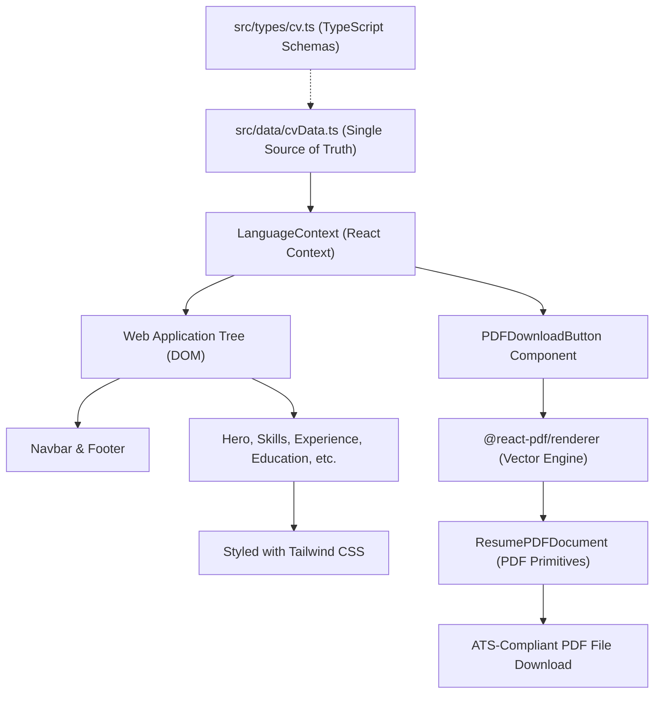

# Curriculum Vitae & Professional Portfolio

> A modern, high-performance, bilingual (English & Spanish) web resume and ATS-compliant vector PDF generator built with **React 19**, **Vite 6**, **TypeScript 5**, and **Tailwind CSS**. Deployed seamlessly to **Google Firebase Hosting** and containerized with **Docker & Nginx**.

[](https://react.dev/)
[](https://vitejs.dev/)
[](https://www.typescriptlang.org/)
[](https://tailwindcss.com/)
[](https://firebase.google.com/docs/hosting)
[](https://www.docker.com/)
[](LICENSE)

*Read this in other languages: [Español (README.es.md)](README.es.md).*

---

## Overview

In today's tech hiring landscape, software engineers and technical leaders need two distinct representations of their career:
1. **An interactive, responsive web portfolio** that recruiters, engineering managers, and colleagues can explore smoothly with dark/light themes and instant bilingual switching.
2. **A clean, single-page or multi-page PDF resume** that passes automated **Applicant Tracking Systems (ATS)** without formatting corruption, unparseable tables, or image-rasterized text.

This project solves both requirements with a **single source of truth** architecture. Built with **React 19** and **Vite**, all resume data resides in structured TypeScript files (`src/data/cvData.ts`), decoupling content from presentation. The web view renders an elegant, mobile-friendly interface styled with **Tailwind CSS**, while the PDF export button invokes `@react-pdf/renderer` in real time to generate an ATS-optimized, selectable vector PDF on the client side.

### Key Capabilities
- 🌐 **Instant Bilingual Support (EN / ES)**: Toggle seamlessly between English and Spanish across the entire web interface and exported PDF.
- 📄 **ATS-Compliant PDF Generation**: Uses client-side `@react-pdf/renderer` to build accessible, machine-readable PDF documents on the fly with true selectable vector text.
- 🎨 **Adaptive Cobalt & Navy Theme**: Designed with an engineering aesthetic featuring clear contrast, smooth transitions, and persistent user preferences.
- ⚡ **Zero-Latency Static Hosting**: Optimized SPA bundling served via Google Firebase Hosting and automated continuous deployment (CI/CD) on GitHub Actions.
- 🐳 **Production-Grade Docker Containerization**: Multi-stage Alpine container serving optimized assets behind a hardened Nginx reverse proxy with gzip compression and cache headers.

---

## Table of Contents

- [Overview](#overview)
- [Quick Start](#quick-start)
- [Prerequisites](#prerequisites)
- [Installation](#installation)
- [Configuration](#configuration)
  - [Customizing Resume Content](#customizing-resume-content)
  - [Firebase Configuration](#firebase-configuration)
- [Usage](#usage)
  - [Interactive Web Portfolio](#interactive-web-portfolio)
  - [Exporting ATS-Compliant PDF](#exporting-ats-compliant-pdf)
- [Architecture Overview](#architecture-overview)
  - [Data Flow & Single Source of Truth](#data-flow--single-source-of-truth)
  - [Dual Render Pipeline](#dual-render-pipeline)
- [Project Structure](#project-structure)
- [Development](#development)
  - [Available Scripts](#available-scripts)
  - [Strict Type-Checking Gate](#strict-type-checking-gate)
- [API & Data Schema Reference](#api--data-schema-reference)
- [Testing](#testing)
- [Deployment](#deployment)
  - [Google Firebase Hosting (Manual)](#google-firebase-hosting-manual)
  - [Continuous Deployment (GitHub Actions)](#continuous-deployment-github-actions)
  - [Docker & Docker Compose](#docker--docker-compose)
- [Troubleshooting & FAQ](#troubleshooting--faq)
- [Contributing](#contributing)
- [License](#license)
- [Acknowledgments](#acknowledgments)

---

## Quick Start

Get the development environment up and running in three steps:

```bash
# 1. Install dependencies
npm ci

# 2. Start the local Vite development server
npm run dev

# 3. Open your browser at http://localhost:5173
```

Alternatively, launch the pre-configured Docker container:

```bash
docker compose up --build -d
# Access at http://localhost:8080
```

---

## Prerequisites

Ensure the following tools are installed on your machine:

| Requirement | Recommended Version | Purpose |
|-------------|---------------------|---------|
| **Node.js** | `>= 20.x` (or `22.x`) | Runtime environment |
| **npm** | `>= 10.x` | Package manager |
| **Docker** *(Optional)* | `>= 24.x` | Containerized production preview |
| **Docker Compose** *(Optional)* | `>= 2.20.x` | Multi-container orchestration |
| **Firebase CLI** *(Optional)* | `latest` (`firebase-tools`) | Manual deployments to Firebase |

---

## Installation

1. **Clone the repository**:
   ```bash
   git clone https://github.com/ronald32acunadev/curriculumvitae.git
   cd curriculumvitae
   ```

2. **Install exact dependencies**:
   ```bash
   npm ci
   ```

3. **Verify build integrity**:
   ```bash
   npm run build
   ```

---

## Configuration

### Customizing Resume Content

All resume copy, personal links, skills, job history, and UI strings live in a centralized, type-safe data module:
👉 [`src/data/cvData.ts`](src/data/cvData.ts)

The file exports:
1. `cvData`: A `BilingualCVData` object structured with `es` and `en` branches.
2. `uiLabels`: A dictionary of translated strings for navigation buttons, section titles, and action badges.

#### Step 1: Update Personal & Contact Information
```typescript
contact: {
  name: "Your Name",
  headline: "Senior Software Architect / Staff Engineer",
  phone: "+1 (555) 019-2834",
  email: "your.email@example.com",
  location: "San Jose, CA, United States",
  linkedinUrl: "https://linkedin.com/in/your-profile",
  githubUrl: "https://github.com/your-username",
  portfolioUrl: "https://your-domain.web.app",
}
```

#### Step 2: Manage Experience & Responsibilities
Each experience item accepts structured dates, workplace models, and metrics-driven bullets:
```typescript
{
  id: "exp-1",
  company: "Enterprise Cloud Solutions Inc.",
  role: "Lead Platform Architect",
  location: "San Francisco, CA (Remote)",
  workplaceType: "Remote",
  startDate: "2021/04",
  endDate: "Present",
  responsibilities: [
    "Architected zero-downtime distributed microservices serving 10M+ daily active requests.",
    "Engineered CI/CD delivery pipelines reducing deployment lead time by 65%."
  ],
  technologies: [".NET 10", "TypeScript", "Azure", "Kubernetes", "Kafka"]
}
```

#### Step 3: Configure Technical & Soft Skills
Group your capabilities into clear categories (`Programming Languages`, `Cloud & DevOps`, `Databases`, etc.):
```typescript
technicalSkills: [
  {
    categoryName: "Programming Languages",
    skills: ["C#", "TypeScript", "Python", "Go", "SQL"]
  }
]
```

### Firebase Configuration

The project is pre-configured to deploy to Firebase Hosting using project ID `curriculum-88377`:
- [`.firebaserc`](.firebaserc): Links the default project alias to your Firebase project.
- [`firebase.json`](firebase.json): Configures the Single-Page Application (SPA) rewrite rules to `/index.html` and sets long-term immutable caching for `/assets/**`.

To point the repository to your own Firebase project:
```bash
npx firebase use --add
```

---

## Usage

### Interactive Web Portfolio

The web client provides an intuitive, high-contrast resume interface:
- **Language Switcher**: Click the flag / language button on the top navigation bar to toggle between English and Spanish. The selection persists in `localStorage` under `cv_language` and synchronizes the HTML `lang` attribute.
- **Section Navigation**: Jump directly to Summary, Technical Skills, Experience, Education, or Certifications with smooth scrolling anchors.
- **Interactive Badges**: Verified credential buttons open external digital badges and certificates in secure tabs (`rel="noopener noreferrer"`).

### Exporting ATS-Compliant PDF

Clicking the **Download CV (PDF)** button initiates client-side generation:
1. The button retrieves the active language slice from `LanguageContext`.
2. `@react-pdf/renderer` dynamically constructs an in-memory document tree (`ResumePDFDocument`).
3. A raw binary Blob is generated and downloaded as `CV_<Name>_<LANG>.pdf`.
4. Output formatting uses single-column flow, standard font definitions (Helvetica), and clean bounding boxes to ensure parsing accuracy across automated recruiting parsers.

---

## Architecture Overview

### Data Flow & Single Source of Truth



### Dual Render Pipeline

1. **Web DOM Target**: Uses standard HTML5 semantic elements (`<header>`, `<main>`, `<section>`, `<article>`), reactive event listeners, and Tailwind CSS utility classes.
2. **PDF Target**: Does not utilize the browser DOM. Instead, it renders via `@react-pdf/renderer` primitives (`<Document>`, `<Page>`, `<View>`, `<Text>`, `<Link>`) with strict pt-based stylesheets. All styling is isolated to avoid web CSS conflicts.

---

## Project Structure

```
curriculumvitae/
├── .github/
│   └── workflows/
│       └── deploy.yml            # Automated CI/CD pipeline on push to main
├── public/                       # Static assets served as-is
├── src/
│   ├── agents/                   # Agent verification and automation scripts
│   │   └── verifyLibraries.agent.ts
│   ├── components/
│   │   ├── layout/               # Header, navigation bar, and footer
│   │   │   ├── Footer.tsx
│   │   │   └── Navbar.tsx
│   │   ├── pdf/                  # ATS PDF renderer and download action
│   │   │   ├── PDFDownloadButton.tsx
│   │   │   └── ResumePDFDocument.tsx
│   │   ├── sections/             # Modular resume sections
│   │   │   ├── CertificationsSection.tsx
│   │   │   ├── ContactSection.tsx
│   │   │   ├── EducationSection.tsx
│   │   │   ├── ExperienceSection.tsx
│   │   │   ├── HeroSection.tsx
│   │   │   ├── SkillsSection.tsx
│   │   │   └── SummarySection.tsx
│   │   └── ui/                   # Reusable UI atoms (Card, Badge, Icons)
│   ├── context/
│   │   └── LanguageContext.tsx   # Bilingual state management and persistence
│   ├── data/
│   │   └── cvData.ts             # Centralized resume content & UI copy
│   ├── test/
│   │   └── setup.ts              # Vitest global setup (localStorage mock)
│   ├── types/
│   │   └── cv.ts                 # TypeScript data contracts & schemas
│   ├── App.tsx                   # Main layout container
│   ├── index.css                 # Base Tailwind styles & custom fonts
│   └── main.tsx                  # React 19 application entry point
├── Dockerfile                    # Multi-stage production container definition
├── docker-compose.yml            # Docker orchestration configuration
├── firebase.json                 # Firebase Hosting rewrites and caching
├── nginx.conf                    # Hardened Nginx configuration for Docker
├── package.json                  # Scripts and dependency versions
├── tailwind.config.js            # Tailwind typography and theme palette
├── tsconfig.app.json             # Strict TypeScript compiler options
└── vite.config.ts                # Vite build and Vitest configuration
```

---

## Development

### Available Scripts

| Command | Action | Output / Target |
|---------|--------|-----------------|
| `npm run dev` | Starts Vite local development server with HMR | `http://localhost:5173` |
| `npm run build` | Runs strict type checking (`tsc -b`) and Vite production bundler | `dist/` |
| `npm run preview` | Spins up a local static server to preview production build | `http://localhost:4173` |
| `npm test` | Runs the full Vitest test suite once (non-watching) | Console report |
| `npm run deploy` | Runs `build` and deploys static assets to Firebase Hosting | Firebase Live Channel |

### Strict Type-Checking Gate

The production build runs `tsc -b` with strict validation enabled (`strict: true`, `noUnusedLocals: true`, `noUnusedParameters: true`). Any unused variable, missing interface attribute, or dead import in application code or tests will fail the build before bundling.

---

## API & Data Schema Reference

The core domain model is defined in [`src/types/cv.ts`](src/types/cv.ts):

```typescript
export interface ContactInfo {
  name: string;
  headline: string;
  phone: string;
  email: string;
  secondaryEmails?: string[];
  location: string;
  linkedinUrl?: string;
  githubUrl?: string;
  portfolioUrl?: string;
  instagramUrl?: string;
  facebookUrl?: string;
}

export interface ExperienceItem {
  id: string;
  company: string;
  role: string;
  location: string;
  workplaceType: 'Remote' | 'On-Site' | 'Hybrid';
  startDate: string;
  endDate: string;
  responsibilities: string[];
  technologies?: string[];
}

export interface EducationItem {
  id: string;
  degree: string;
  institution: string;
  location: string;
  startDate: string;
  endDate: string;
  description?: string;
}

export interface CertificationItem {
  id: string;
  title: string;
  issuer: string;
  date: string;
  verificationUrl?: string;
  credentialType?: 'online' | 'physical';
}

export interface CVContent {
  contact: ContactInfo;
  summary: string;
  languages: Array<{ name: string; level: string }>;
  softSkills: string[];
  technicalSkills: Array<{ categoryName: string; skills: string[] }>;
  experience: ExperienceItem[];
  education: EducationItem[];
  certifications: CertificationItem[];
}
```

---

## Testing

The testing suite uses **Vitest** configured with **jsdom** and **React Testing Library**:

- **Context Testing** ([`contexts.test.tsx`](src/context/contexts.test.tsx)): Validates language toggling, fallback detection, and `localStorage` synchronization.
- **Component Testing** ([`sections.test.tsx`](src/components/sections/sections.test.tsx), [`Navbar.test.tsx`](src/components/layout/Navbar.test.tsx)): Ensures all sections render correctly across locales and viewports.
- **PDF Generation Testing** ([`ResumePDFDocument.test.ts`](src/components/pdf/ResumePDFDocument.test.ts)): Confirms document tree construction without runtime errors.
- **Data Integrity Testing** ([`cvData.test.ts`](src/data/cvData.test.ts)): Enforces parity between Spanish (`es`) and English (`en`) datasets.

To execute tests:
```bash
# Run all unit tests
npm test

# Target a specific test suite
npx vitest run src/context/contexts.test.tsx

# Target a specific test by name filter
npx vitest run src/components/sections/sections.test.tsx -t "renders HeroSection"
```

---

## Deployment

### Google Firebase Hosting (Manual)

To deploy your portfolio to Firebase Hosting manually:

1. Log into your Firebase account:
   ```bash
   npx firebase login
   ```
2. Verify your project association:
   ```bash
   npx firebase use curriculum-88377
   ```
3. Run the automated build and deployment script:
   ```bash
   npm run deploy
   ```

### Continuous Deployment (GitHub Actions)

The repository includes a ready-to-use GitHub Actions workflow located in [`.github/workflows/deploy.yml`](.github/workflows/deploy.yml).

Every `push` to the `main` branch automatically:
1. Clones the repository and provisions Node.js 20.
2. Installs dependencies cleanly via `npm ci`.
3. Runs the test suite via `npm test`.
4. Builds the production bundle via `npm run build`.
5. Deploys to Firebase Hosting live channel (`curriculum-88377`).

#### Setting up GitHub Secrets:
1. Generate a service account private key in the [Firebase Console](https://console.firebase.google.com/project/curriculum-88377/settings/serviceaccounts/adminsdk).
2. Add a new repository secret under **Settings > Secrets and variables > Actions**.
3. Name the secret `FIREBASE_SERVICE_ACCOUNT_CURRICULUM_88377` (or `FIREBASE_SERVICE_ACCOUNT`) and paste the downloaded JSON credentials.

### Docker & Docker Compose

For containerized hosting or offline local evaluation:

```bash
# Build the image and start the container in detached mode
docker compose up --build -d

# Check running status
docker compose ps

# View container logs
docker compose logs -f

# Gracefully shut down the container
docker compose down
```

The container maps host port `8080` to container port `80`, serving static files through Nginx with custom gzip compression and security headers (`X-Frame-Options`, `X-Content-Type-Options`).

---

## Troubleshooting & FAQ

### 1. `sh: 1: vitest: not found` or missing dependencies
**Cause**: Dependencies have not been installed in your local environment.  
**Solution**: Run `npm ci` (or `npm install`) from the project root.

### 2. Build fails during `npm run build` due to unused variables
**Cause**: The TypeScript compiler enforces `noUnusedLocals` and `noUnusedParameters` strictly across all files, including tests.  
**Solution**: Remove any unused imports or variables before triggering production builds.

### 3. PDF layout does not mirror Tailwind classes
**Cause**: `@react-pdf/renderer` uses a native PDF layout engine and does not support web CSS or Tailwind class names.  
**Solution**: Adjust layout properties directly in [`src/components/pdf/ResumePDFDocument.tsx`](src/components/pdf/ResumePDFDocument.tsx) using the `StyleSheet.create` object.

### 4. Port `8080` is already in use by another Docker process
**Cause**: Another service is bound to port 8080 on the host machine.  
**Solution**: Change the port mapping in `docker-compose.yml` (e.g., `"8081:80"`).

---

## Contributing

Contributions, feedback, and issue reports are welcome. When submitting changes:
1. Maintain the bilingual data structure (`es` and `en`) in [`cvData.ts`](src/data/cvData.ts).
2. Ensure strict TypeScript types pass cleanly via `npm run build`.
3. Add corresponding unit tests for new features.
4. Follow [Conventional Commits](https://www.conventionalcommits.org/) standards.

---

## License

This project is open-source under the [MIT License](LICENSE). Personal curriculum content, biographical summaries, and contact details belong to the author.

---

## Acknowledgments

- [React Team](https://react.dev/) for React 19.
- [Vite](https://vitejs.dev/) for instant tooling and lightning-fast HMR.
- [@react-pdf/renderer](https://react-pdf.org/) for programmatic client-side vector PDF composition.
- [Lucide Icons](https://lucide.dev/) for lightweight, clean vector iconography.
- [Tailwind CSS](https://tailwindcss.com/) for ergonomic utility styling.
